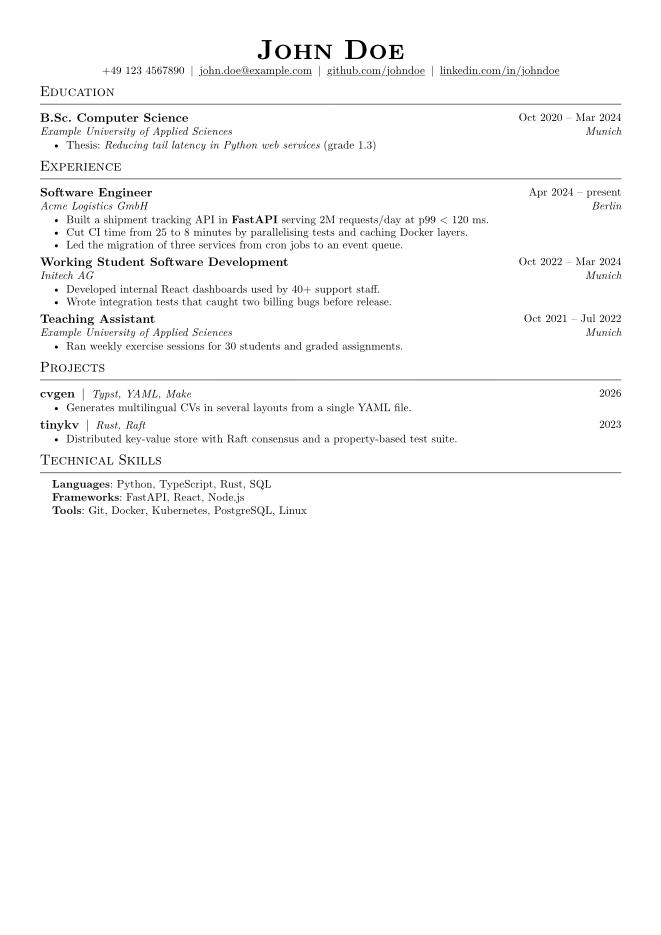
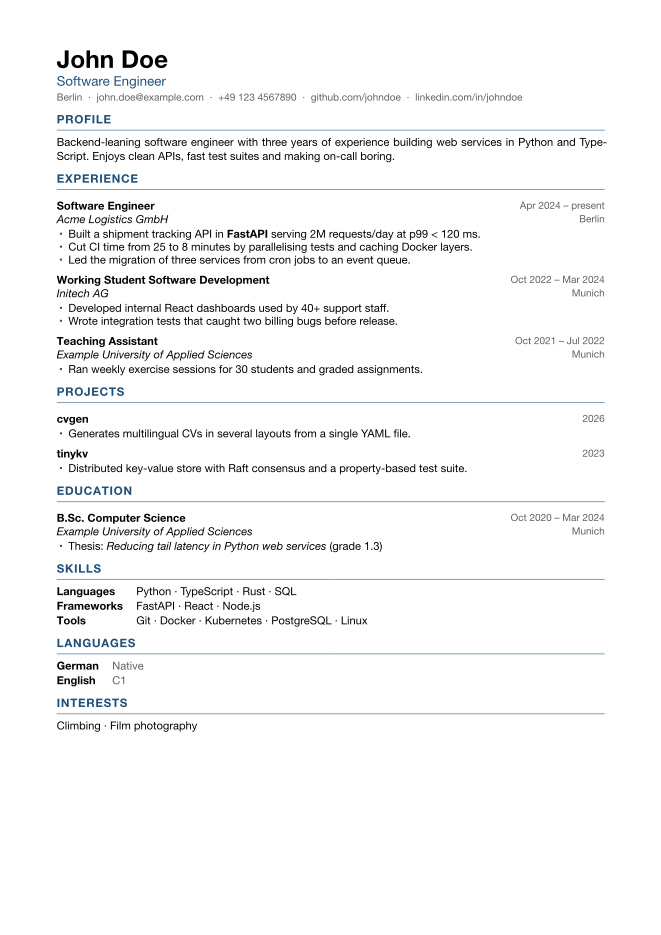

# cvgen

Write your CV once in YAML and render it with [Typst](https://typst.app) in several
languages, layouts and section selections.

| `jake` theme | `classic` theme |
| --- | --- |
|  |  |

## Quick start

Requires [Typst](https://github.com/typst/typst) ≥ 0.13 and `make`.

```sh
cp data/cv.example.yaml data/cv.yaml   # your real data, gitignored
make                                   # every variant × language into out/
```

## How it works

Everything lives in **one file**, `data/cv.yaml`: your content plus render presets.

- **Content**: a text field is either a plain string or one
  value per language: `{ en: Experience, de: Berufserfahrung }`. A missing language
  falls back to `meta.default_lang`. Text can use Typst markup (`*bold*`, `#link(..)[..]`).
- **Variants** (the `variants:` block at the bottom) decide what goes into each PDF:

  ```yaml
  variants:
    jake:
      theme: jake            # classic | jake
      lang: en
      paper: a4              # or us-letter
      sections:              # order here = order in the PDF; omitted = hidden
        - education
        - experience
        - { id: projects, include_tags: [dev], limit: 3 }
        - { id: skills, title: { en: Technical Skills } }
      hide_items: [old-job]  # item ids to drop
  ```

- **Section types** set how a section renders: `text`, `timeline`, `grouped`, `levels`,
  `list`. A new section (awards, volunteering, …) only needs data, no template change.
- **Themes** live in `template/themes/`. Each exports `apply`, `render-header`,
  `section-heading` and `renderers`. Register a new one in `cv.typ`.

## Build

```sh
make                              # all variants × languages
make de                           # all variants in German
make one VARIANT=jake LANG_=en    # a single PDF
make watch VARIANT=jake           # live preview → out/cv-watch.pdf
```

Or directly:

```sh
typst compile --root . cv.typ out/cv.pdf \
  --input data=data/cv.yaml --input variant=jake --input lang=en
```

Variant names must not contain `-` (the Makefile splits `cv-<variant>-<lang>` on it).

## Extending

Need a section the example doesn't have, an extra field, or another template? See
[AGENTS.md](AGENTS.md). In short:

1. **New section** (awards, publications, …): add it under `sections` with an existing
   `type` and list it in a variant. No template change.
2. **New field** (e.g. `url` on projects): add it to the data, read it in every theme with a
   `none` default.
3. **New section type**: add a renderer to every theme in `template/themes/`.
4. **New template**: copy a theme file, implement `apply`, `render-header`,
   `section-heading` and `renderers`, register it in `cv.typ`. AGENTS.md has a mapping
   guide for porting LaTeX templates.

## Credits

The `jake` theme is a Typst port of [Jake's Resume](https://github.com/jakegut/resume)
by Jake Gutierrez (MIT), which is based on [sb2nov/resume](https://github.com/sb2nov/resume).
